# Service Material Tracker — User Manual

A step-by-step guide to every role in the system, with screenshots. If you
just want to understand what the app *is* and how it's built, see
`1_APPLICATION_OVERVIEW.md` instead — this document is about how to
actually use it.

Every page has the same toolbar at the top: a search box, a part-type
filter, a date range, and a sort order — use these to narrow down a long
list before you start working.

---

## Logging in

Go to the app's login page, enter your email and password, and sign in.
Which page you land on depends on your **role** — you don't choose it, the
system sends you straight to it.

---

## 1. Engineer

The Engineer's home page lists every faulty part you've logged, split into
two tabs: **Pending** (not yet shipped out) and **Dispatched** (already on
its way).

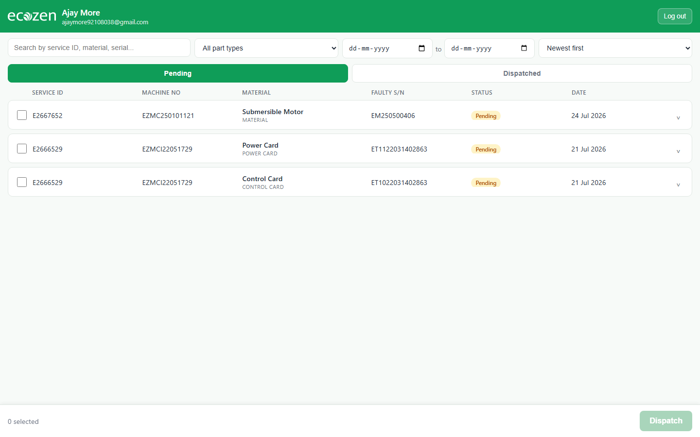

**To dispatch material:**
1. Tick the checkbox next to one or more pending items.
2. Click **Dispatch** at the bottom right.
3. Fill in the Pickup Number, LR Number, Delivery Challan Number, choose a
   Delivery Partner and a Destination (a warehouse), add any remarks, and
   click **Confirm Dispatch**.

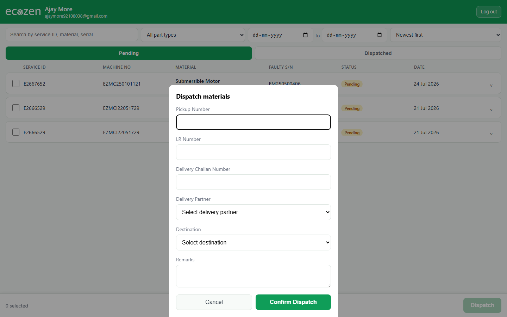

---

## 2. Regional Warehouse

Some material is routed through a Regional Warehouse first. Its home page
has five tabs: **Incoming**, **Tested OK**, **Repaired**, **Dispatched to
OEM**, and **Dispatched to Warehouse**.

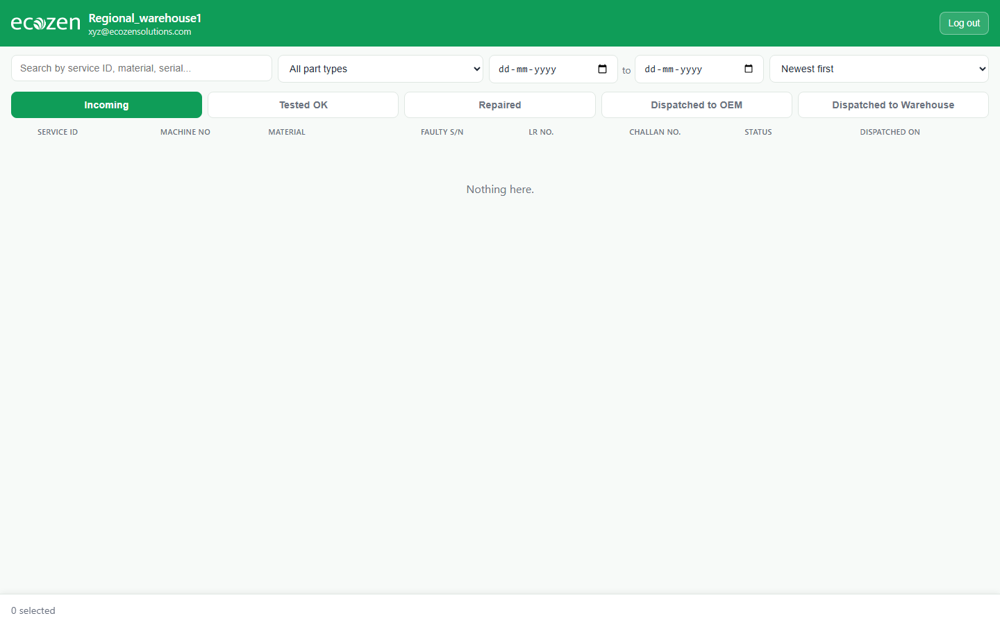

**For an incoming item, you have two kinds of action:**
- **Simple status update** (Tested OK / Repaired / Dispatched to OEM) — select
  the item, click the matching button, add an optional remark, and confirm.
- **Forward it on to the Main Warehouse** — select the item, click
  **Dispatch**, and fill in the same shipment details an Engineer would
  (Pickup Number, LR Number, Challan Number, Delivery Partner, and which
  warehouse it's going to).

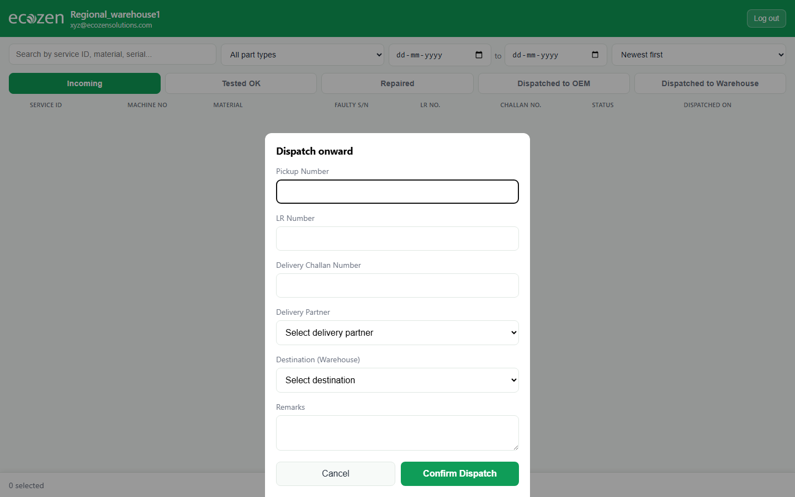

---

## 3. Main Warehouse

This is the busiest page — it has a tab for every stage a part can be in on
its way through the warehouse: **Incoming**, **Pending OEM/Scrap**, **With
Service Desk**, **With Electronics**, **Repaired from Electronics**,
**Added to Stock**, **Dispatched to OEM**, and **Scrapped**.

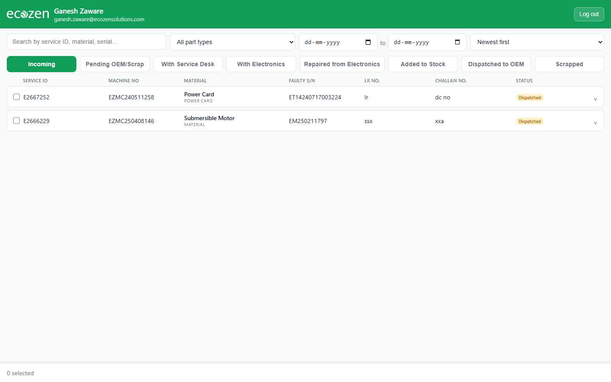

**Receiving an incoming Power Card / Control Card / RMU:**
Select it and click **Receive**. Record the date it physically arrived,
whether the serial number on the part matches the paperwork, a reservation
number, and (if it doesn't match) a mandatory remark explaining why.

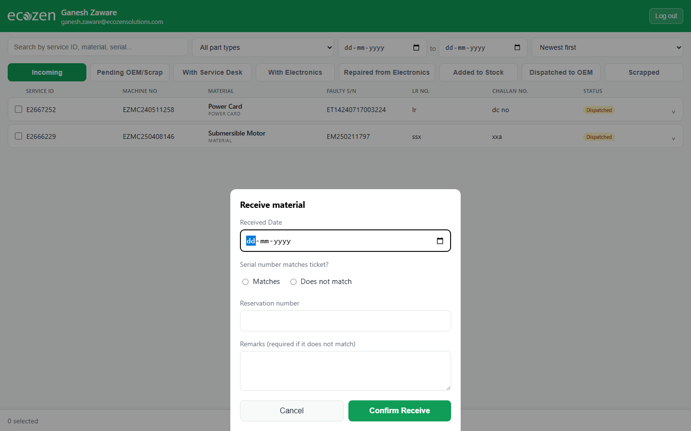

> A Power/Control Card whose serial number starts with **P**, or any
> motor/pump, skips Service Desk and Electronics entirely — after
> receiving, it goes straight to a **Dispatch to OEM / Scrap** decision
> instead (see below).

**Dispatch to OEM / Scrap** (for motors, pumps, and the P-serial cards just
described): select the item and click the matching button. Record the
inward and outward reservation numbers and an optional remark.

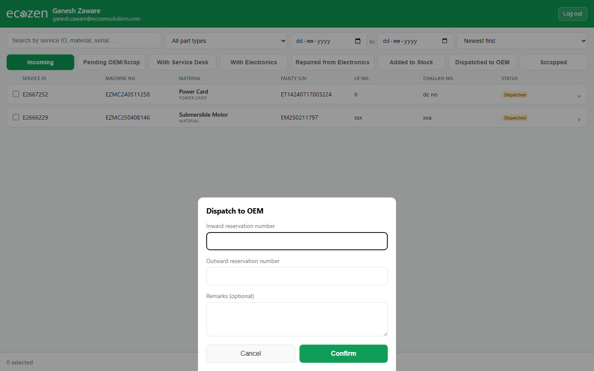

**Add to Stock** (once Electronics has repaired something and sent it
back): select it, click **Add to Stock**, enter the outward reservation
number, and confirm. This is the last step in a part's journey.

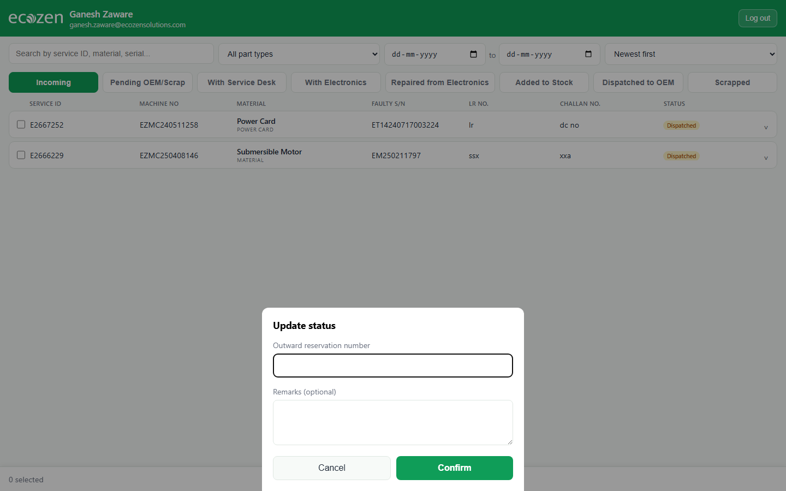

---

## 4. Service Desk

Two tabs: **Pending Inspection** and **With Electronics**.

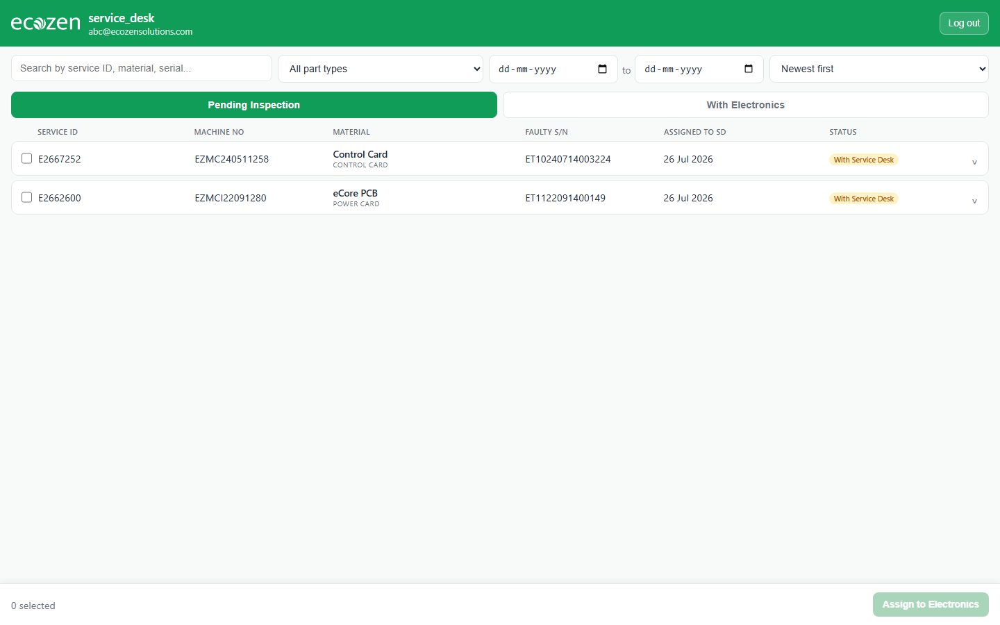

**To inspect and assign to Electronics:** select one or more pending
items, click **Assign to Electronics**, and fill in the full inspection
checklist — every field here is required:

- Problem description
- Visual inspection done? (Yes/No)
- MTR test (Passed/Failed)
- Cold test (Passed/Failed)
- Wiring (Repaired/Was OK)
- Remark

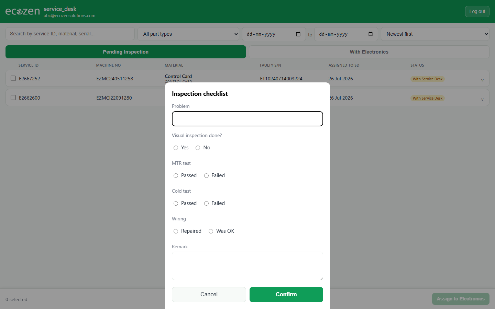

---

## 5. Electronics

Four tabs: **Pending Decision**, **Completed**, **Sent Back to Warehouse**,
and **Scrapped**.

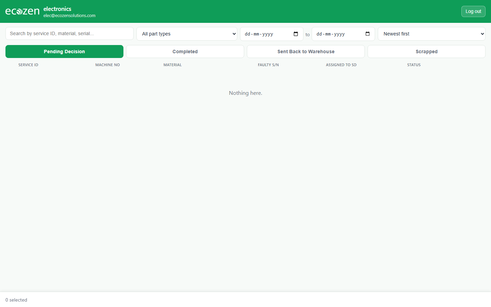

**Step 1 — Diagnose.** Select a pending item and click **Proceed** to open
the full diagnostic checklist: your name, initial observation, PCB type,
PCB issue, category of failure, sub category (you can pick more than one —
type to search), IGBT pin status, the component actually changed, the test
machine used, the tested date, and finally a **Final Remark** of Repaired
OK, Tested OK, or Scrapped. Submitting this moves the item to the
**Completed** tab.

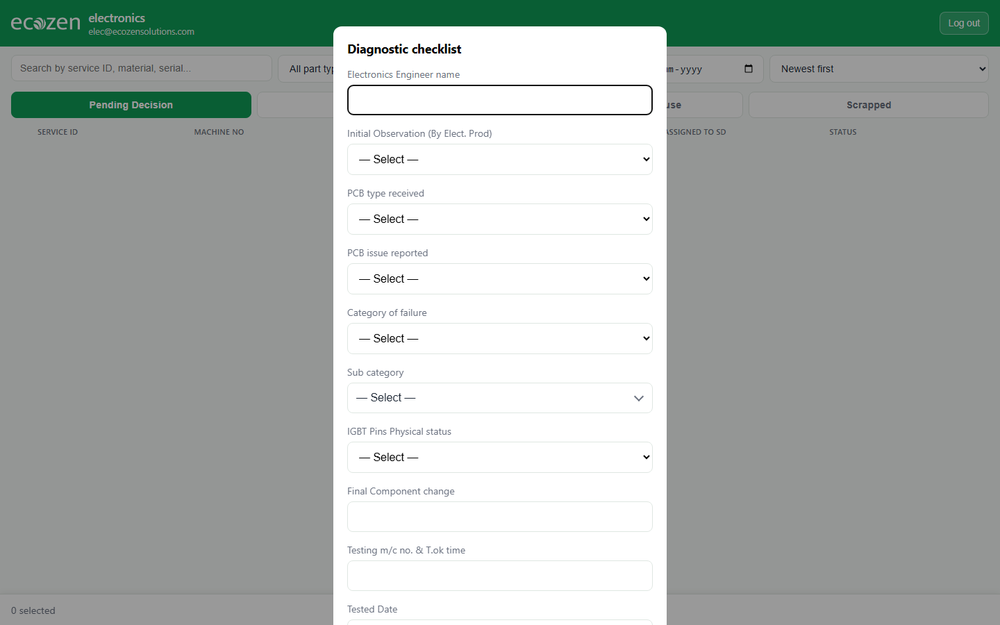

**Step 2 — Dispose.** In the Completed tab, select the item. Depending on
what you picked as the Final Remark, you'll see either a **Send Back to
Warehouse** button or a **Scrap** button (only one applies — it's decided
by the remark you already gave it). Either way, a small dialog asks for the
outward reservation number.

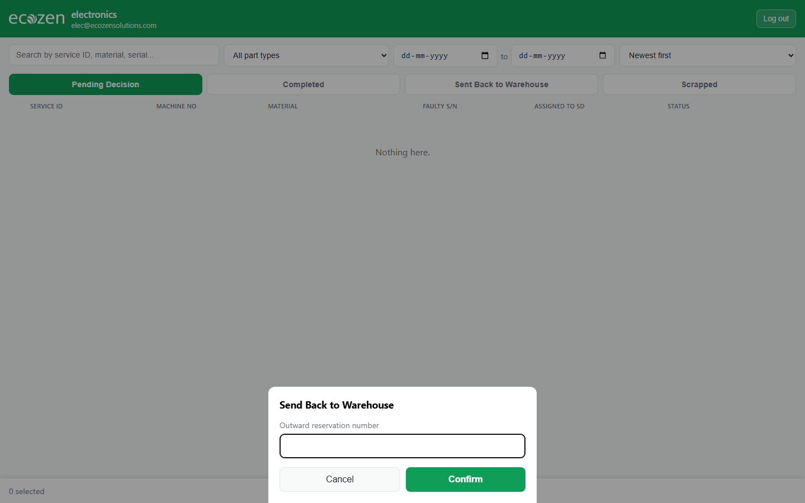

---

## 6. Admin

The Admin Dashboard is a separate area with its own sidebar, reachable only
by an Admin login. It doesn't act on individual parts — it's for
oversight, user management, and reporting.

### Dashboard Overview
Every material in the system, in one place, with a tab per stage across the
*entire* pipeline (not just one role's slice of it). Filterable by part
type, engineer, and date, on top of the usual search and sort.

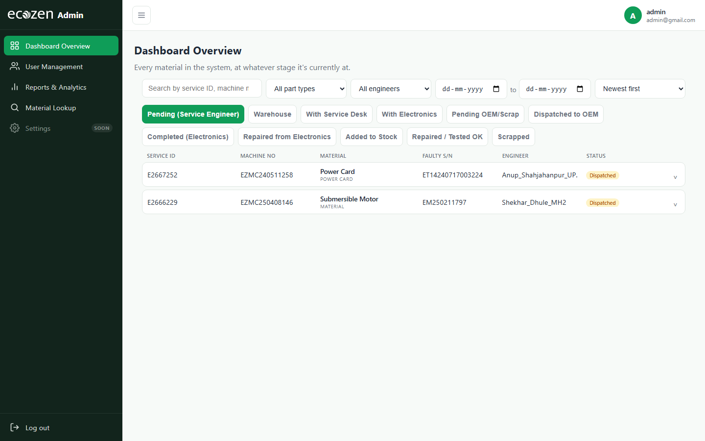

### User Management
See every login, its role, and whether it's active. From here you can:
- **+ Add User** — create a new login (name, email, password, role).
- **Change Password** / **Change Role** — per-account, via a small dialog.
- **Activate / Deactivate** — one click, no dialog.

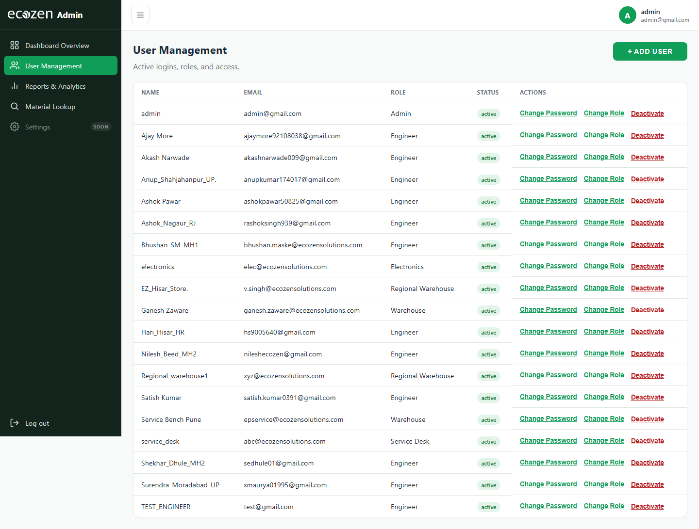
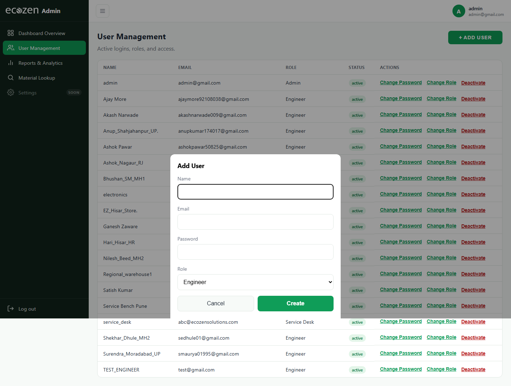

### Reports & Analytics
Two at-a-glance charts: how many materials are sitting at each stage right
now, and which components/faults come up most often (pulled from
Electronics' own diagnostic notes).

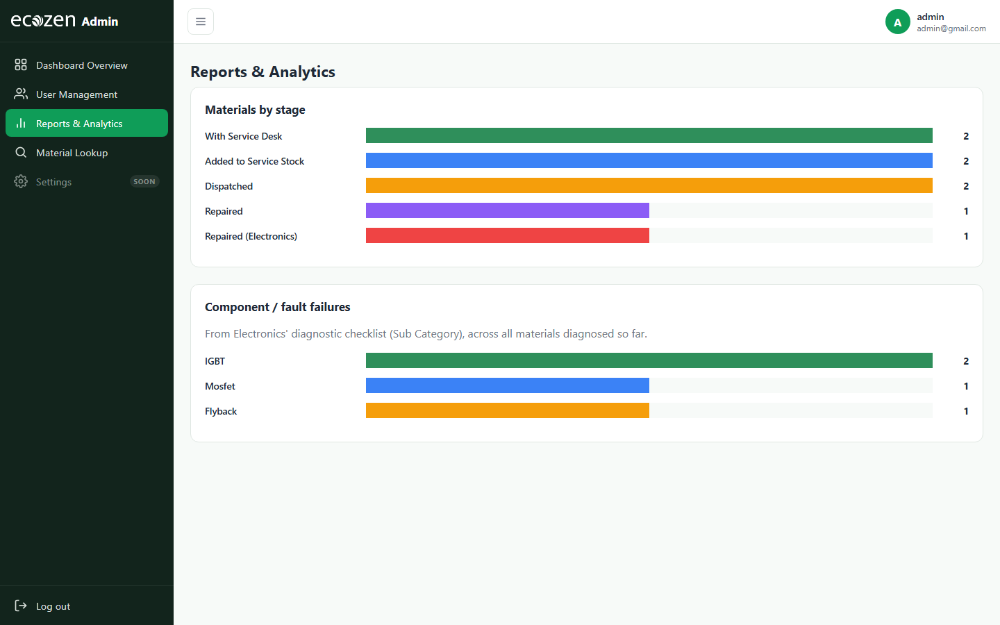

### Material Lookup
Search by Service ID, machine number, or faulty serial number. Every match
shows its full history — every stage it has passed through, who touched
it, and when — from the moment it was first dispatched to wherever it is
(or ended up) now.

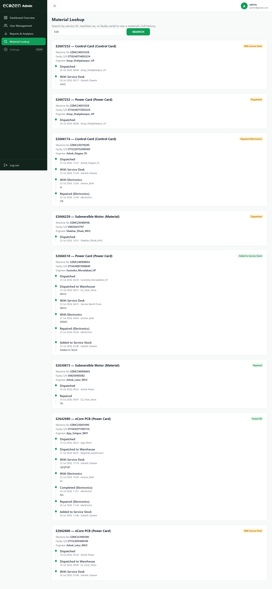
